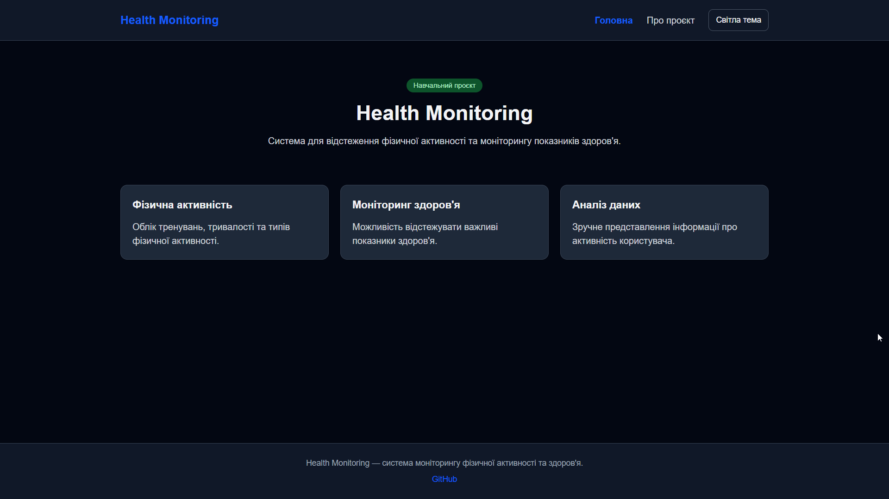
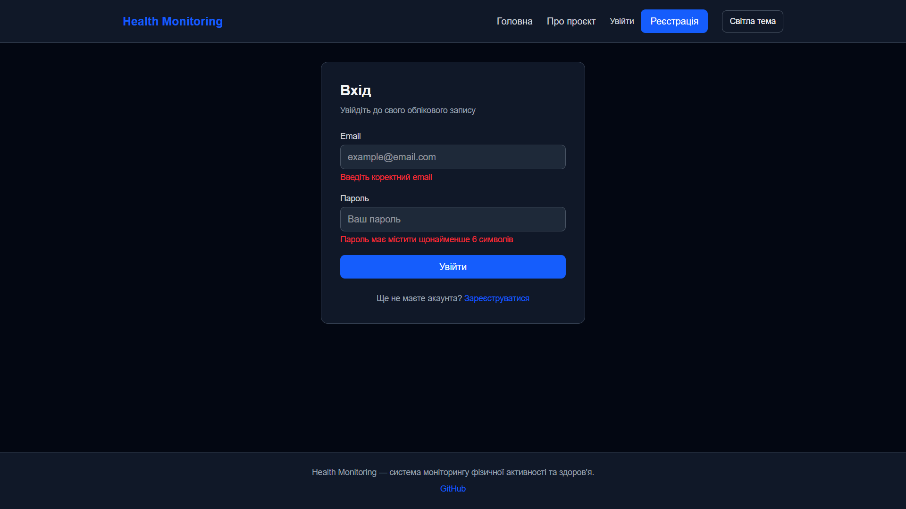
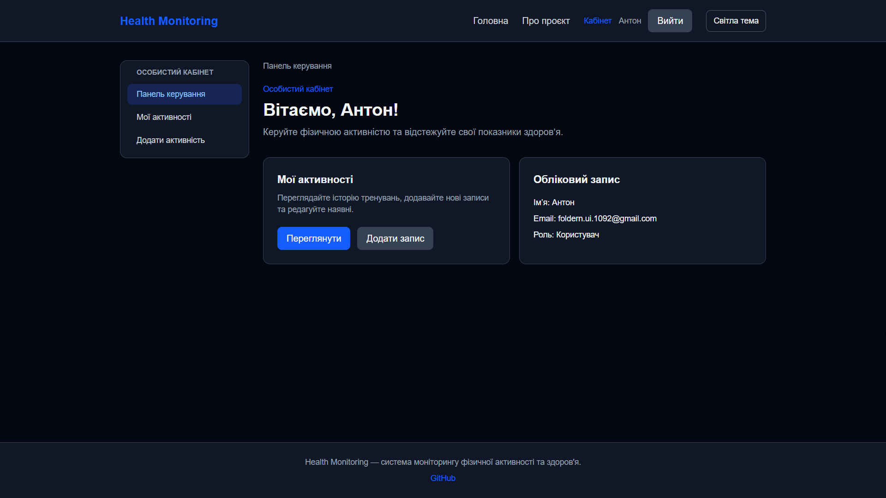
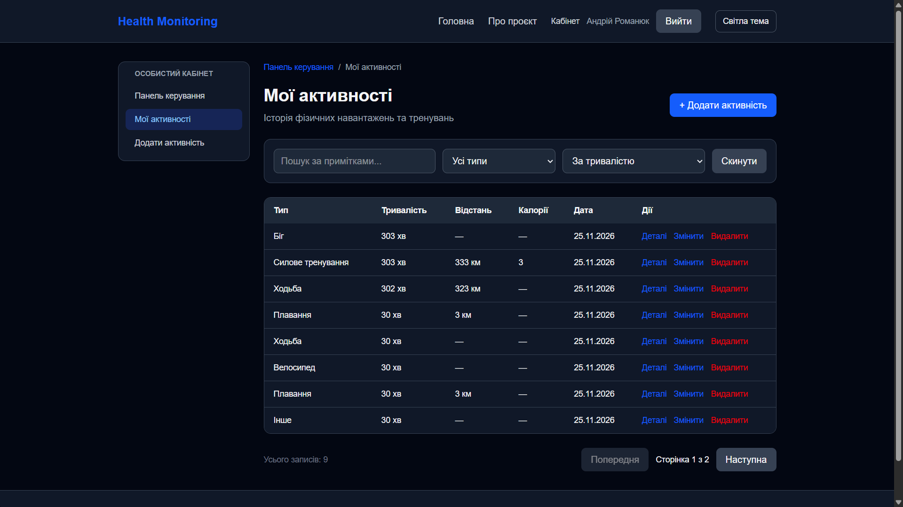
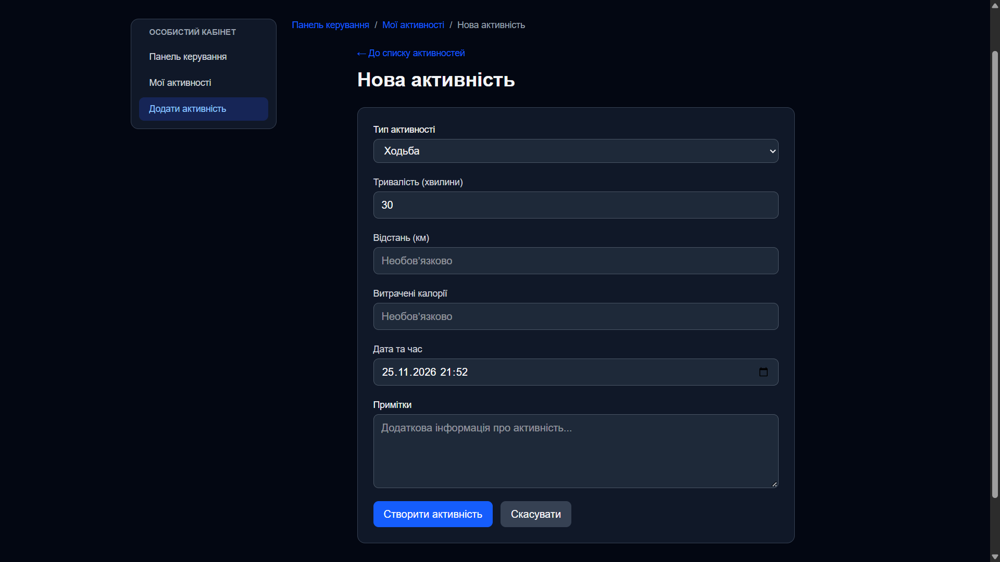
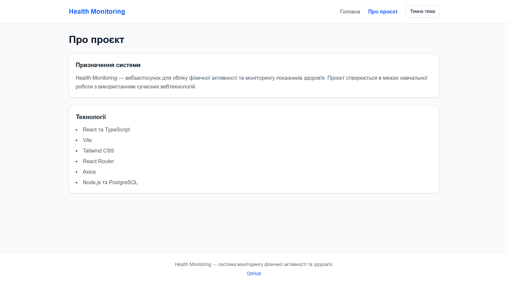
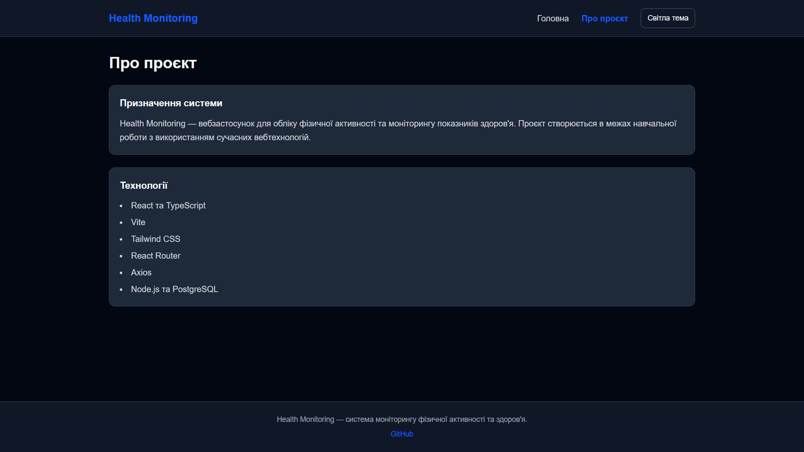

# Health Monitoring

Вебзастосунок для моніторингу фізичної активності та показників здоров'я. Проєкт складається із серверної частини на Node.js та клієнтського інтерфейсу на React.

## Технології

### Backend
- Node.js та Express.js
- PostgreSQL
- Prisma ORM
- JWT для автентифікації
- Argon2id для хешування паролів
- Socket.IO для обміну даними в реальному часі
- Multer для завантаження файлів
- Swagger / OpenAPI для документації API
- Helmet та express-rate-limit для базового захисту

### Frontend
- React та TypeScript
- Vite
- Tailwind CSS
- React Router
- Zustand для керування станом автентифікації
- TanStack Query для роботи із серверними даними
- Axios для HTTP-запитів
- React Hook Form та Zod для роботи з формами та валідації
- ESLint та Prettier
- Socket.IO Client для обміну даними в реальному часі
- Recharts для графіків статистики
- DnD Kit для Drag and Drop
- Vitest та React Testing Library для тестування
- Vite PWA для підтримки Progressive Web App

## Реалізовані можливості

### Серверна частина
- Реєстрація, вхід, оновлення та відкликання токенів.
- Розмежування доступу за ролями USER та ADMIN.
- CRUD-операції для користувачів та активностей.
- Пагінація, фільтрація та пошук активностей.
- Завантаження, перегляд списку та видалення файлів.
- Перевірка типу та розміру файлів.
- JWT-авторизація Socket.IO-з'єднань.
- Персональні кімнати користувачів та події активностей у реальному часі.
- Індекси PostgreSQL для оптимізації запитів до активностей.
- Swagger-документація, захисні HTTP-заголовки та обмеження частоти запитів авторизації.

### Клієнтська частина
- Адаптивний інтерфейс на React та TypeScript.
- Реєстрація, вхід і вихід з облікового запису.
- Керування станом автентифікації за допомогою Zustand.
- Захищені маршрути для авторизованих користувачів.
- Особистий кабінет із навігацією та інформацією про користувача.
- Перегляд, створення, редагування та видалення фізичних активностей.
- Перегляд детальної інформації про активність.
- Валідація форм за допомогою React Hook Form та Zod.
- Керування серверними даними за допомогою TanStack Query.
- Пошук із затримкою введення (debounce).
- Фільтрація активностей за типом.
- Сортування за датою, тривалістю, відстанню, калоріями та типом.
- Пагінація списку активностей.
- Повторно використовувані компоненти таблиці, списку та сітки даних.
- Індикатори завантаження та skeleton loaders.
- Відображення повідомлень про успішні операції та помилки.
- Breadcrumbs для навігації між сторінками.
- Бічна панель навігації з адаптацією для мобільних пристроїв.
- Світла та темна теми оформлення зі збереженням налаштування.
- Обробка помилок за допомогою Error Boundary.
- Отримання оновлень активностей у реальному часі через Socket.IO.
- Система сповіщень із лічильником непрочитаних повідомлень.
- Статистичні картки та графік фізичної активності.
- Перетягування статистичних карток за допомогою Drag and Drop.
- Інтерактивні вкладки, модальні вікна та пошукові списки.
- Відкладене завантаження сторінок для оптимізації продуктивності.
- Підтримка PWA та встановлення застосунку.
- Автоматизовані тести React-компонентів.

## Посилання

- **GitHub:** https://github.com/Fackell/health-monitoring
- **Production API:** https://health-monitoring-grk9.onrender.com
- **Swagger:** https://health-monitoring-grk9.onrender.com/api-docs
- **Health check:** https://health-monitoring-grk9.onrender.com/api/health

## Структура проєкту

```text
health-monitoring/
├── docs/                  # Документація та звіти лабораторних
├── frontend/              # React-клієнт
│   ├── public/
│   ├── screenshots/       # Скріншоти інтерфейсу
│   ├── src/
│   │   ├── components/    # UI-компоненти та компоненти макета
│   │   ├── hooks/
│   │   ├── pages/
│   │   ├── schemas/
│   │   ├── services/
│   │   ├── stores/
│   │   ├── types/
│   │   └── utils/
│   ├── .env.example
│   └── package.json
├── prisma/                # Схема та міграції бази даних
├── src/                   # Серверна частина
├── tests/                 # Автоматичні тести
├── .env.example
├── .gitignore
└── README.md
```

## Локальний запуск

### Вимоги

- Node.js
- npm
- PostgreSQL

### Backend

Клонуйте репозиторій:

```bash
git clone https://github.com/Fackell/health-monitoring.git
cd health-monitoring
```

Встановіть залежності:

```bash
npm ci
```

Створіть файл `.env` на основі `.env.example` та вкажіть власні значення змінних середовища. Не використовуйте тестові або production-секрети з чужого середовища.

Основні змінні:

| Змінна | Призначення |
|---|---|
| DATABASE_URL | Рядок підключення до PostgreSQL |
| JWT_SECRET | Секрет access-токенів |
| JWT_EXPIRES_IN | Термін дії access-токена |
| REFRESH_TOKEN_SECRET | Секрет refresh-токенів |
| REFRESH_TOKEN_EXPIRES_IN | Термін дії refresh-токена |
| UPLOAD_DIR | Каталог завантажених файлів |
| MAX_FILE_SIZE | Максимальний розмір файлу в байтах |
| FRONTEND_URL | Дозволене джерело клієнтської частини |
| PORT | Порт сервера |

Згенеруйте Prisma Client та застосуйте міграції:

```bash
npx prisma generate
npx prisma migrate deploy
```

Запуск у режимі розробки:

```bash
npm run dev
```

Звичайний запуск:

```bash
npm start
```

Після запуску API доступне за адресою `http://localhost:3000`, документація — `http://localhost:3000/api-docs`.

### Frontend

Відкрийте окремий термінал та перейдіть до каталогу клієнтської частини:

```bash
cd frontend
```

Встановіть залежності:

```bash
npm ci
```

Створіть файл `.env.development` на основі `.env.example` та налаштуйте адресу API:

```env
VITE_API_URL=http://localhost:3000/api
VITE_APP_NAME=Health Monitoring
```

Для production використовується файл `.env.production` з адресою розгорнутого API.

Запуск у режимі розробки:

```bash
npm run dev
```

Перевірка коду:

```bash
npm run lint
```

Форматування:

```bash
npm run format
```

Production-збірка:

```bash
npm run build
```

Перегляд production-збірки:

```bash
npm run preview
```

## Тестування

Для запуску автоматичних тестів серверної частини:

```bash
npm test
```

Тести перевіряють валідацію реєстрації та входу, захисні HTTP-заголовки, JWT-авторизацію Socket.IO та доставку подій у персональну кімнату.

## Основні маршрути API

| Маршрут | Призначення |
|---|---|
| `/api/health` | Перевірка стану сервера |
| `/api/auth` | Реєстрація, вхід, оновлення та завершення сесії |
| `/api/users` | Операції з користувачами |
| `/api/activities` | Операції з фізичними активностями |
| `/api/files` | Завантаження та керування файлами |
| `/api-docs` | Swagger UI |

Точні методи, параметри та структури запитів наведені у Swagger.

## WebSocket

Для обміну даними використовується Socket.IO. Клієнт передає access JWT під час підключення через `auth.token`. Після успішної перевірки сервер приєднує з'єднання до персональної кімнати `user:<userId>`.

Події активностей:

- `activity:created`
- `activity:updated`
- `activity:deleted`

Докладніше: [docs/websocket.md](docs/websocket.md).

## Розгортання

Серверну частину розгорнуто на Render, база даних PostgreSQL розміщена на Neon.

Build command:

```bash
npm ci && npx prisma generate && npx prisma migrate deploy
```

Start command:

```bash
npm start
```

На Render потрібно налаштувати змінні середовища, зокрема `DATABASE_URL`, `JWT_SECRET`, `JWT_EXPIRES_IN`, `REFRESH_TOKEN_SECRET`, `REFRESH_TOKEN_EXPIRES_IN`, `UPLOAD_DIR`, `MAX_FILE_SIZE` та `FRONTEND_URL`. Значення секретів не зберігаються в репозиторії.

Платформа Render самостійно передає порт через `PORT`.

### Обмеження розгортання

Безкоштовний вебсервіс Render може переходити в режим сну після періоду бездіяльності. Перший запит після цього може виконуватися довше. WebSocket-клієнтам потрібно коректно обробляти розриви з'єднання.

Файлова система без постійного диска є тимчасовою. Тому завантажені на локальний диск файли не слід вважати постійно збереженими після перезапуску чи повторного розгортання. Для production потрібне зовнішнє файлове сховище.

Умови безкоштовних тарифів Render та Neon можуть змінюватися. Перед тривалим використанням необхідно перевіряти актуальні обмеження провайдерів.

## Скріншоти інтерфейсу

### Головна сторінка



### Сторінка входу



### Особистий кабінет



### Список активностей



### Форма створення активності



### Темна тема



### Сторінка про проєкт



## Додаткова документація

- [WebSocket API](docs/websocket.md)
- [Звіт лабораторної роботи №3](docs/lab-03-report.md)
