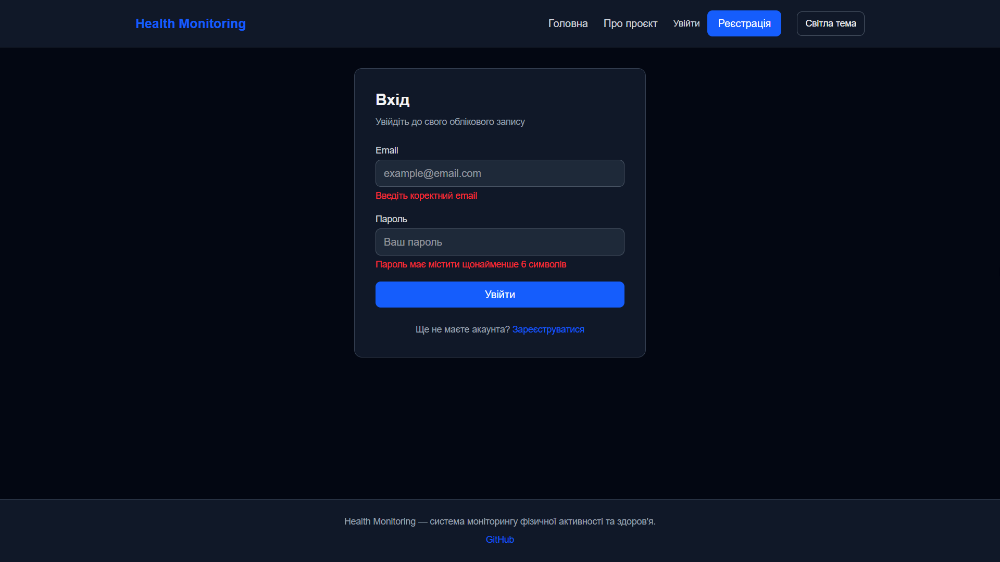
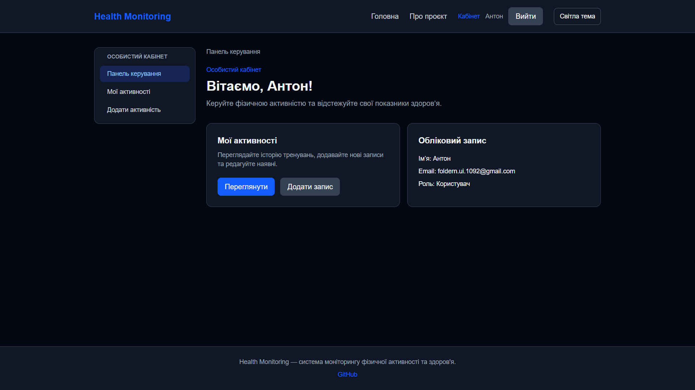
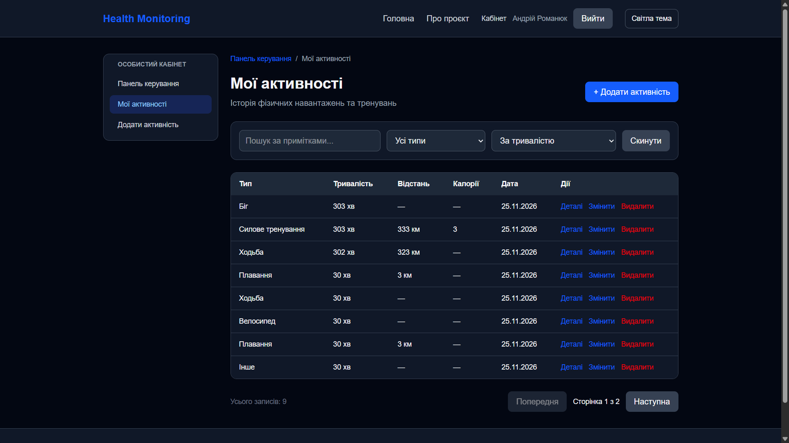
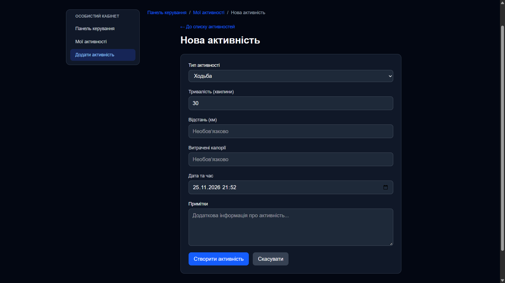

# Звіт з лабораторної роботи №5

**Тема:** Розроблення основного інтерфейсу та функціоналу вебзастосунку

**Дисципліна:** [Назва дисципліни]

**Виконав:** [ПІБ студента]

**Група:** [Назва групи]

**Дата виконання:** 25.11.2026

---

## 1. Мета роботи

Здобути практичні навички створення повнофункціонального користувацького інтерфейсу із системою автентифікації, керуванням станом, валідацією форм та реалізацією CRUD-операцій для взаємодії з API серверної частини.

## 2. Завдання роботи

У межах лабораторної роботи необхідно:

1. Створити сторінки входу та реєстрації користувачів.
2. Реалізувати автентифікацію за допомогою Zustand.
3. Створити захищені маршрути.
4. Розробити панель керування з навігацією.
5. Реалізувати вихід із системи.
6. Додати індикатори завантаження та обробку помилок.
7. Реалізувати перегляд, створення, редагування та видалення записів.
8. Додати валідацію форм за допомогою React Hook Form та Zod.
9. Створити повторно використовувані компоненти для відображення даних.
10. Реалізувати пагінацію, пошук, фільтрацію та сортування.
11. Використати TanStack Query для роботи із серверними даними.
12. Додати сповіщення, детальні сторінки, breadcrumbs та skeleton loaders.
13. Реалізувати адаптивну бічну панель навігації.
14. Оновити документацію проєкту та додати скриншоти інтерфейсу.

## 3. Використані технології

Під час виконання роботи використовувалися такі технології:

| Технологія | Призначення |
|---|---|
| React | Створення користувацького інтерфейсу |
| TypeScript | Статична типізація |
| Vite | Інструмент розробки та збирання |
| Tailwind CSS | Стилізація інтерфейсу |
| React Router | Маршрутизація |
| Zustand | Керування станом автентифікації |
| TanStack Query | Отримання та кешування серверних даних |
| Axios | HTTP-запити до API |
| React Hook Form | Робота з формами |
| Zod | Валідація даних |
| ESLint | Перевірка якості коду |
| Prettier | Форматування коду |

## 4. Хід виконання роботи

### 4.1. Реалізація автентифікації

Було створено сторінки входу та реєстрації користувачів.

Для керування станом автентифікації використано Zustand. Сховище відповідає за збереження інформації про поточного користувача, токенів доступу та оновлення стану після входу або виходу із системи.

Для збереження стану між перезавантаженнями сторінки використано механізм persist.

Взаємодія із сервером здійснюється через Axios та відповідні API-сервіси. Під час авторизованих запитів використовується JWT-токен.

### 4.2. Захищені маршрути та навігація

Реалізовано компонент ProtectedRoute, який перевіряє наявність авторизованого користувача перед відкриттям захищених сторінок.

Якщо користувач не авторизований, його перенаправляє на сторінку входу.

Також реалізовано вихід із системи, після якого очищується стан автентифікації та виконується перенаправлення на сторінку входу.

Для навігації створено компоненти Header, Sidebar та Breadcrumbs. Бічна панель адаптується до розміру екрана та підтримує мобільний режим.

### 4.3. Панель керування

Створено сторінку Dashboard, яка є основною сторінкою авторизованого користувача.

На панелі керування відображаються:
- привітання з іменем користувача;
- інформація про фізичні активності;
- посилання для перегляду та додавання записів;
- інформація про обліковий запис користувача.

Для організації інформації використано повторно використовувані компоненти DataGrid та DataList.

### 4.4. Робота із фізичними активностями

Реалізовано основні CRUD-операції для фізичних активностей:

- **Create** — створення нового запису;
- **Read** — перегляд списку та детальної інформації;
- **Update** — редагування існуючого запису;
- **Delete** — видалення запису з підтвердженням дії.

Для роботи з API створено відповідні сервіси та власні React-хуки.

Серверні дані отримуються та оновлюються за допомогою TanStack Query. Після успішного виконання операцій зміни синхронізуються з кешем запитів.

### 4.5. Форми та валідація

Для роботи з формами використано React Hook Form, а для перевірки введених даних — Zod.

Реалізовано форми входу, реєстрації, створення та редагування фізичних активностей.

Перевірка даних відбувається перед надсиланням запиту на сервер. У разі некоректного введення користувач отримує повідомлення про помилку.

### 4.6. Пошук, фільтрація та сортування

На сторінці списку активностей реалізовано пошук за примітками до записів із використанням debounce.

Затримка пошуку становить 500 мілісекунд, що дозволяє уникнути зайвих запитів під час введення тексту.

Також реалізовано:
- фільтрацію за типом фізичної активності;
- сортування за датою;
- сортування за тривалістю;
- сортування за відстанню;
- сортування за кількістю спалених калорій;
- сортування за типом активності.

Для навігації між результатами використовується пагінація з обмеженням у 8 записів на сторінку.

### 4.7. Повторно використовувані компоненти

Для покращення структури та повторного використання коду створено компоненти:

- DataTable — відображення табличних даних;
- DataList — відображення структурованих списків;
- DataGrid — компонування елементів у сітку;
- Skeleton — скелетні індикатори завантаження;
- Button — кнопки з різними варіантами оформлення;
- Input — поля введення;
- Card — інформаційні картки;
- Badge — позначки та статуси;
- Loading — індикатори завантаження;
- ErrorBoundary — обробка помилок React-компонентів.

### 4.8. Обробка помилок та індикатори завантаження

Додано відображення станів завантаження під час отримання даних із сервера.

Для списку активностей реалізовано skeleton loaders, які показують структуру таблиці до завершення завантаження.

Також передбачено відображення помилок під час невдалих запитів та повідомлень про результати операцій.

### 4.9. Оновлення документації

Оновлено файл README.md у корені проєкту.

До документації додано:
- актуальний перелік технологій;
- опис реалізованих можливостей клієнтської частини;
- оновлену структуру проєкту;
- інструкції з локального запуску;
- інформацію про API та розгортання;
- скриншоти основних сторінок застосунку.

## 5. Результати тестування

Після реалізації функціональності було проведено ручну перевірку основних можливостей застосунку.

| Перевірка | Результат |
|---|---|
| Реєстрація користувача | Успішно |
| Вхід до системи | Успішно |
| Вихід із системи | Успішно |
| Перенаправлення неавторизованого користувача | Успішно |
| Створення фізичної активності | Успішно |
| Перегляд списку активностей | Успішно |
| Перегляд деталей активності | Успішно |
| Редагування активності | Успішно |
| Видалення активності | Успішно |
| Пошук за примітками | Успішно |
| Фільтрація за типом | Успішно |
| Збереження змін після перезавантаження сторінки | Успішно |

Додатково виконано перевірку клієнтської частини:

- Prettier — успішно;
- ESLint — помилок не виявлено;
- Production build — успішно.

Під час production-збирання Vite вивів попередження про розмір JavaScript-файлу, який перевищує 500 КБ. Це попередження не перешкоджає успішному завершенню збірки.

## 6. Скріншоти результатів роботи

### 6.1. Сторінка входу

### 6.2. Панель керування

### 6.3. Список фізичних активностей

### 6.4. Форма створення активності

## 7. Висновок

Під час виконання лабораторної роботи було розроблено та вдосконалено клієнтську частину вебзастосунку Health Monitoring.

Реалізовано систему автентифікації користувачів, захищені маршрути, панель керування та навігацію. Створено інтерфейси для перегляду, створення, редагування й видалення фізичних активностей.

Для керування станом застосунку використано Zustand, а для роботи із серверними даними — TanStack Query. Валідацію форм реалізовано за допомогою React Hook Form та Zod.

Також додано пошук із затримкою введення, фільтрацію, сортування, пагінацію, повторно використовувані компоненти, індикатори завантаження та адаптивну навігацію.

У результаті роботи отримано функціональну клієнтську частину, інтегровану із серверним API проєкту Health Monitoring. Поставлену мету лабораторної роботи досягнуто.